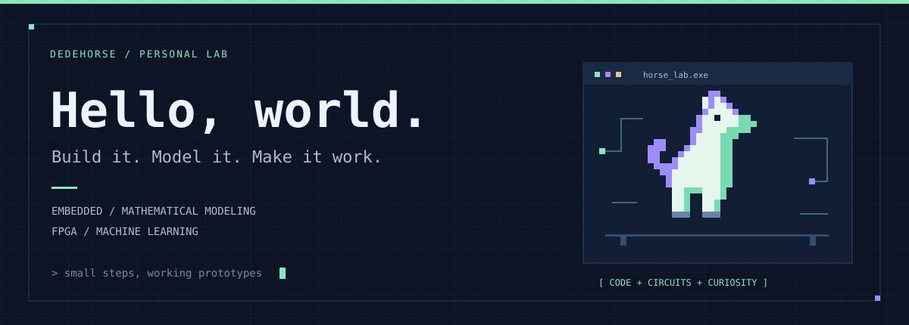
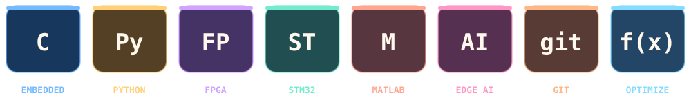
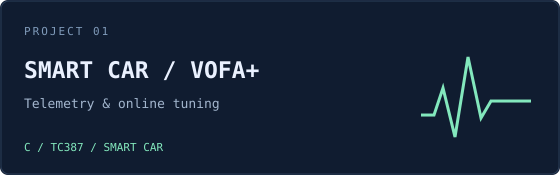
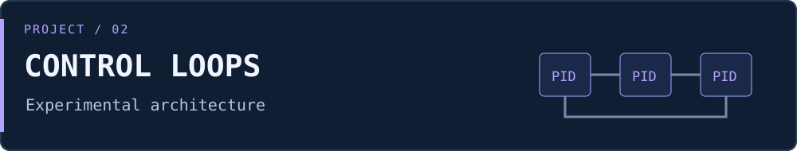

<p align="center">
  <picture>
    <source media="(max-width: 600px)" srcset="assets/hero-mobile.svg" />
    
  </picture>
</p>

<p align="center"><b>中南大学在读本科生 · 嵌入式 / FPGA / 数学建模</b></p>
<p align="center"><picture><source media="(max-width: 600px)" srcset="assets/typing-mobile.svg" /></picture></p>

<p align="center">
  <a href="#关于我--about-me">关于我</a> ·
  <a href="#钻研中-ing">钻研中 ing</a> ·
  <a href="#公开项目">公开项目</a> ·
  <a href="#数模档案">数模档案</a> ·
  <a href="#实验与学习">实验与学习</a>
</p>

## 关于我 · About me

```python
class Dedehorse:
    location = "中南大学"
    interests = ["嵌入式", "FPGA", "数学建模", "端侧 AI"]
    building = ["器材核对系统", "节奏可视学习屏"]
    workflow = "建模 → 实现 → 调试 → 验证"
    motto = "把想法做成能运行的东西"
```

从智能车的摄像头、控制环和串口波形出发，边做边学，也记录调试过程和实验边界。

## 技术与工具 · Tech stack

<p align="center"><picture><source media="(max-width: 600px)" srcset="assets/tech-tiles-mobile.svg" /></picture></p>

<p align="center"><sub>常用工具与正在实践的方向</sub></p>

## 钻研中 ing

> 实验台还亮着，下面是近期正在推进的项目。

<table>
<tr>
<td width="50%" valign="top">
<p><sub>01 / FPGA · 进行中</sub></p>
<p><b>器材核对系统</b></p>
<p>正式工程整理与相机冻结实验。</p>
<p><b>下一步</b><br />多槽图像冻结、分类和异常图音反馈；完成实板与时序验证。</p>
</td>
<td width="50%" valign="top">
<p><sub>02 / FPGA · 进行中</sub></p>
<p><b>节奏可视学习屏</b></p>
<p>面向听障学生的节拍练习原型。</p>
<p><b>下一步</b><br />验证 HDMI 画面与音频、跟拍反馈和延迟校准。</p>
</td>
</tr>
</table>

<sub>本地开发中 · 记录每一次上板、调试和功能迭代。</sub>

## 公开项目

<table class="project-grid">
<tr>
<td width="50%" valign="top">
<a href="https://github.com/dedehorse/21th-smart-car-vofa"></a>
<p><b>智能车 · VOFA+ 调试与控制</b></p>
<p>基于 TC387 的智能车工程，围绕赛道感知、方向与速度控制、无线遥测和在线调参展开。</p>
<p><a href="https://github.com/dedehorse/21th-smart-car-vofa">查看代码与说明 →</a></p>
</td>
<td width="50%" valign="top">
<a href="https://github.com/dedehorse/21th-smart-car-three-cascade-loop"></a>
<p><b>智能车 · 三串级控制实验</b></p>
<p>探索方向 / 角度、角速度与速度环的分层控制，配套图像处理和调试输出。实验版本，实车验证尚不完整。</p>
<p><a href="https://github.com/dedehorse/21th-smart-car-three-cascade-loop">查看代码与说明 →</a></p>
</td>
</tr>
</table>

## 数模档案

从题目拆解、数据处理、模型求解，到图表、论文和结果复核，整理成可追溯的项目过程。

<details>
<summary><b>展开 4 项数模项目与工作流</b></summary>

| 项目 | 做过的内容 | 资料状态 |
| :--- | :--- | :--- |
| **电池退化与寿命预测** · 2026 策联杯 A 题 | 数据审计、SOH 短期预测、寿命外推与不确定性分析、充电策略多目标优化 | 本地有代码、图表与论文 |
| **微网与外部电网电力调控** · 2026 国赛 C 题 | 调控策略建模、结果计算、图表与论文材料整理 | 本地有代码与交付材料 |
| **复杂地形车机协同配送** · 湖南省研究生数模题目实践 | 道路网络、无人车–无人机协同、调度与选址优化、独立结果校验 | 本地有代码、结果与论文 |
| **数模工作流与工具整理** | 分析建模 → 代码出图 → 流程图 → 论文 → 验收；维护阶段报告与使用记录 | 本地工作流与 skills |

目前展示项目简介，代码、图表与论文材料在本地整理。

</details>

## 实验与学习

<details>
<summary><b>嵌入式、FPGA 与端侧 AI</b></summary>

| 项目 | 实践内容 | 状态 |
| :--- | :--- | :--- |
| **手写识别与 STM32 部署** | MNIST / EMNIST、模型转换、X-CUBE-AI、STM32 与 PC 上位机 | 本地工程与实验 |
| **STM32H7R3 摄像头实验** | 图像采集、LCD 显示、二值化与 PC 端查看 | 板级实验与调试 |
| **H7R3 界面动画** | 像素动画帧、资源转换与 Flash 存储 | 本地界面实验 |
| **膝关节监测原型** | STM32H7 方案、模拟数据与随机森林训练 | 方案与算法原型，未完成完整系统验证 |
| **FPGA 多媒体实验** | 相机、TF 图片、HDMI 显示与音频 | 已有实板基础，继续集成验证 |
| **EDA-Robot 机器狗** | 电路、结构、固件与组装资料学习 | 第三方项目学习 / 复现资料整理 |

</details>

<details>
<summary><b>机器学习与计算机视觉</b></summary>

| 方向 | 项目与练习 |
| :--- | :--- |
| 目标检测 | YOLOv5 口罩检测：数据集整理、训练与推理工程 |
| 图像分类 | CIFAR-10 分类实验；花卉图像分类学习项目 |
| 结构化数据 | 房价预测、Titanic 生存预测学习项目 |
| 图像工具 | 二维码与条形码识别脚本 |

从基础练习开始，逐步补齐数据处理、训练、评估与部署。

</details>

<details>
<summary><b>AI 工具与工作流</b></summary>

- Codex skills 与数模流程整理：减少重复配置，让过程和结果更容易复核。
- AI 辅助写作、文档排版与演示材料制作。
- Agent、MCP 与桌面工具的配置和使用实践。

</details>

## GitHub 动态 · Activity

<p align="center">
  <a href="https://github.com/dedehorse?tab=repositories"></a>
</p>

<p align="center"><sub>公开仓库活动自动更新；本地数模与硬件实验不计入 GitHub 贡献。</sub></p>


---

<p align="center"><sub>Code, circuits & curiosity. · 认真记录每一个跑起来的小东西。</sub></p>

<p align="center"></p>
