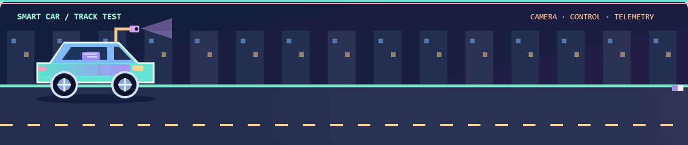

<p align="center">
  <picture>
    <source media="(max-width: 600px)" srcset="assets/hero-mobile.svg" />
    
  </picture>
</p>

<p align="center"><b>中南大学在读本科生 · 智能车 / 嵌入式控制 / AI / 数学建模 / FPGA</b></p>
<p align="center"><picture><source media="(max-width: 600px)" srcset="assets/typing-mobile.svg" /></picture></p>

<p align="center">
  <a href="#关于我--about-me">关于我</a> ·
  <a href="#智能车--smart-car">智能车</a> ·
  <a href="#钻研中-ing">钻研中 ing</a> ·
  <a href="#公开项目">公开项目</a> ·
  <a href="#数模档案">数模档案</a> ·
  <a href="#实验与学习">实验与学习</a>
</p>

## 关于我 · About me

```python
class Dedehorse:
    location = "中南大学"
    interests = ["智能车", "嵌入式控制", "计算机视觉", "数学建模", "FPGA"]
    building = ["智能车识别与控制优化", "乳腺超声影像分析"]
    workflow = "建模 → 实现 → 调试 → 验证"
    motto = "把想法做成能运行的东西"
```

从智能车的摄像头、控制环和串口波形出发，边做边学，也记录调试过程和实验边界。

<p align="center">
  <picture>
    <source media="(prefers-reduced-motion: reduce) and (max-width: 600px)" srcset="assets/smart-car-mobile-static.png" />
    <source media="(prefers-reduced-motion: reduce)" srcset="assets/smart-car-static.png" />
    <source media="(max-width: 600px)" srcset="assets/smart-car-mobile.gif" />
    
  </picture>
</p>

## 技术与工具 · Tech stack

<p align="center">
  <picture>
    <source media="(max-width: 600px)" srcset="https://skillicons.dev/icons?i=c%2Cpython%2Cmatlab%2Cgit%2Cvscode%2Carduino%2Cpytorch%2Copencv&amp;theme=dark&amp;perline=4" />
    
  </picture>
</p>

<p align="center"><sub>C · Python · MATLAB · Git · VS Code · Arduino · PyTorch · OpenCV</sub></p>

## 智能车 · Smart car

我围绕第 21 届智能车竞赛做 TC387 车模工程，把摄像头赛道识别、方向与速度控制、无线遥测及 VOFA+ 在线调参连成一个闭环。公开仓库保留比赛使用的工程和三串级控制实验分支；后者还需要完整的实车验证。

**接下来**：检查新车模的编码器反馈，继续优化赛道识别与控制参数，用波形和低速实车测试记录每次调整。

## 钻研中 ing

> 近期主要在做智能车迭代和乳腺超声影像分析项目的结果与文档复核；其他硬件想法也继续在实验台上推进。

<table>
<tr>
<td width="50%" valign="top">
<p><sub>01 / 智能车 · 持续优化</sub></p>
<p><b>赛道识别与控制调试</b></p>
<p>基于 TC387 智能车现有工程，梳理摄像头识别、方向与速度环，以及 VOFA+ 的调参记录。</p>
<p><b>下一步</b><br />核对新车模编码器反馈，逐项调整识别与控制参数；通过波形和低速实车测试验证效果。</p>
</td>
<td width="50%" valign="top">
<p><sub>02 / 计算机视觉 · 项目整理中</sub></p>
<p><b>乳腺超声影像分析</b></p>
<p>在 ModelArts / MindSpore 上完成乳腺超声图像分类、病灶框检测与轮廓分割的实验和结果分析。</p>
<p><b>下一步</b><br />核对三项指标与平台证据，整理误差案例和实验报告；如实写明模型局限。</p>
</td>
</tr>
<tr>
<td colspan="2" valign="top">
<p><sub>03 / FPGA · 原型推进中</sub></p>
<p><b>器材核对系统 / 节奏可视学习屏</b></p>
<p>前者探索相机画面冻结、多槽分类与异常反馈；后者面向听障学生，尝试把节拍练习做成可视画面和声音反馈。</p>
<p><b>下一步</b><br />继续核对实板时序、HDMI 画面与音频链路，按验证结果推进集成。</p>
</td>
</tr>
</table>

## 公开项目

<table class="project-grid">
<tr>
<td width="50%" valign="top">
<a href="https://github.com/dedehorse/21th-smart-car-vofa"></a>
<p><b>智能车 · VOFA+ 调试与控制</b></p>
<p>第 21 届智能车比赛工程：TC387 + 摄像头识别赛道，以方向环和速度环控制车辆，并通过 VOFA+ 观察波形、在线调参。</p>
<p><a href="https://github.com/dedehorse/21th-smart-car-vofa">查看代码与说明 →</a></p>
</td>
<td width="50%" valign="top">
<a href="https://github.com/dedehorse/21th-smart-car-three-cascade-loop"></a>
<p><b>智能车 · 三串级控制实验</b></p>
<p>方向 / 角度、角速度与左右轮速度的分层控制实验，配套图像处理和调试输出。与比赛工程分开保存，完整实车验证仍待完成。</p>
<p><a href="https://github.com/dedehorse/21th-smart-car-three-cascade-loop">查看代码与说明 →</a></p>
</td>
</tr>
</table>

## 数模档案

从题目拆解、数据处理、模型求解，到图表、论文和结果复核，整理成可追溯的项目过程。

<details>
<summary><b>展开 4 项数模项目与工作流</b></summary>

| 项目 | 做过的内容 | 资料状态 |
| :--- | :--- | :--- |
| **电池退化与寿命预测** · 2026 策联杯 A 题 | 数据审计、SOH 短期预测、寿命外推与不确定性分析、充电策略多目标优化 | 本地有代码、图表与论文 |
| **微网与外部电网电力调控** · 2026 国赛 C 题 | 调控策略建模、结果计算、图表与论文材料整理 | 本地有代码与交付材料 |
| **复杂地形车机协同配送** · 湖南省研究生数模题目实践 | 道路网络、无人车–无人机协同、调度与选址优化、独立结果校验 | 本地有代码、结果与论文 |
| **数模工作流与工具整理** | 分析建模 → 代码出图 → 流程图 → 论文 → 验收；维护阶段报告与使用记录 | 本地工作流与 skills |

目前展示项目简介，代码、图表与论文材料在本地整理。

</details>

## 实验与学习

<details>
<summary><b>嵌入式、FPGA 与端侧 AI</b></summary>

| 项目 | 实践内容 | 状态 |
| :--- | :--- | :--- |
| **手写识别与 STM32 部署** | MNIST / EMNIST、模型转换、X-CUBE-AI、STM32 与 PC 上位机 | 本地工程与实验 |
| **STM32H7R3 摄像头实验** | 图像采集、LCD 显示、二值化与 PC 端查看 | 板级实验与调试 |
| **H7R3 界面动画** | 像素动画帧、资源转换与 Flash 存储 | 本地界面实验 |
| **膝关节监测原型** | STM32H7 方案、模拟数据与随机森林训练 | 方案与算法原型，未完成完整系统验证 |
| **FPGA 多媒体实验** | 相机、TF 图片、HDMI 显示与音频 | 已有实板基础，继续集成验证 |
| **EDA-Robot 机器狗** | 电路、结构、固件与组装资料学习 | 第三方项目学习 / 复现资料整理 |

</details>

<details>
<summary><b>机器学习与计算机视觉</b></summary>

| 方向 | 项目与练习 |
| :--- | :--- |
| 目标检测 | YOLOv5 口罩检测：数据集整理、训练与推理工程 |
| 图像分类 | CIFAR-10 分类实验；花卉图像分类学习项目 |
| 结构化数据 | 房价预测、Titanic 生存预测学习项目 |
| 图像工具 | 二维码与条形码识别脚本 |

从基础练习开始，逐步补齐数据处理、训练、评估与部署。

</details>

<details>
<summary><b>AI 工具与工作流</b></summary>

- [MathModel Unified · 数学建模统一工作流](https://github.com/dedehorse/mathmodel-unified)：公开的 Codex skill，覆盖读题建模、求解出图、论文写作与终审。
- AI 辅助写作、文档排版与演示材料制作。
- Agent、MCP 与桌面工具的配置和使用实践。

</details>

## GitHub 动态 · Activity

<p align="center">
  <a href="https://github.com/dedehorse?tab=repositories"></a>
</p>

<p align="center"><sub>公开仓库活动自动更新；本地数模与硬件实验不计入 GitHub 贡献。</sub></p>


---

<p align="center"><sub>Code, circuits & curiosity. · 认真记录每一个跑起来的小东西。</sub></p>

<p align="center"></p>
