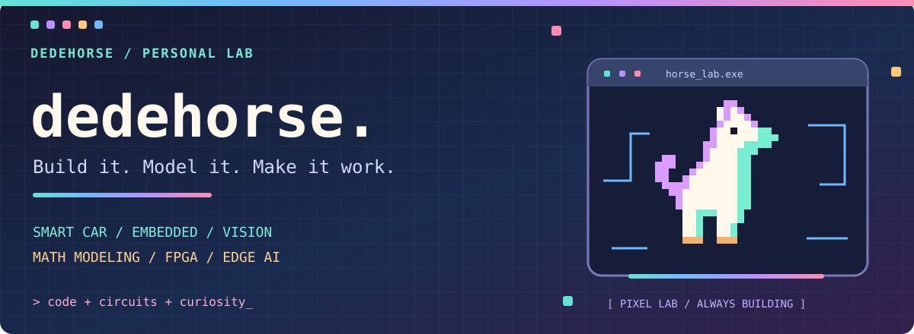

  <picture>
    <source media="(max-width: 600px)" srcset="assets/hero-v8-mobile.svg" />
    
  </picture>

<b>中南大学在读本科生，把想法做成能运行的东西。</b> 智能车 · 嵌入式控制 · 数学建模 · 计算机视觉 · FPGA

  <a href="#精选项目">精选项目</a> ·
  <a href="#钻研中-ing">钻研中 ing</a> ·
  <a href="#技术与工具">技术与工具</a> ·
  <a href="#项目档案">项目档案</a>

## 精选项目

### 01 / 智能车 · 从赛道到控制

  <a href="https://github.com/dedehorse/21th-smart-car-vofa">
    <picture>
      <source media="(prefers-reduced-motion: reduce) and (max-width: 600px)" srcset="assets/smart-car-mobile-static.png" />
      <source media="(prefers-reduced-motion: reduce)" srcset="assets/smart-car-static.png" />
      <source media="(max-width: 600px)" srcset="assets/smart-car-mobile.gif" />
      
    </picture>
  </a>

第 21 届智能车竞赛工程。用摄像头识别赛道，通过方向环与速度环控制车模，再用 VOFA+ 观察波形、无线遥测和在线调参。

`C` · `TC387` · `赛道识别` · `闭环控制`

[查看智能车工程 →](https://github.com/dedehorse/21th-smart-car-vofa)

### 02 / MathModel Unified · 从题目到交付

  <a href="https://github.com/dedehorse/mathmodel-unified">
    <picture>
      <source media="(max-width: 600px)" srcset="assets/modeling-v8-mobile.svg" />
      
    </picture>
  </a>

把数模实践中的读题建模、可复现求解、图表、论文与终审整理成一个可独立安装的 Codex skill。支持完整流程，也支持只做其中一个阶段；组成来源在仓库中说明。

`数学建模` · `Codex skill` · `可复现工作流` · `MIT`

[使用这个 skill →](https://github.com/dedehorse/mathmodel-unified) · [查看组成来源](https://github.com/dedehorse/mathmodel-unified/blob/main/SOURCES.md)

### 03 / 三串级控制 · 把反馈拆开看

  <a href="https://github.com/dedehorse/21th-smart-car-three-cascade-loop">
    <picture>
      <source media="(max-width: 600px)" srcset="assets/control-v8-mobile.svg" />
      
    </picture>
  </a>

探索方向 / 角度、角速度与左右轮速度的分层控制，配套图像处理和调试输出。独立保留实验工程，完整实车验证仍待完成。

`C` · `TC387` · `串级控制` · `实验中`

[查看控制实验 →](https://github.com/dedehorse/21th-smart-car-three-cascade-loop)

## 钻研中 ing

**智能车识别与控制优化** · 持续迭代  
检查新车模编码器反馈，优化赛道识别与控制参数，用波形和低速实车测试验证调整。

**乳腺超声影像分析** · 整理中  
基于 ModelArts / MindSpore 的图像分类、病灶检测与轮廓分割；整理实验结果、误差案例和项目文档。

**FPGA 交互原型** · 开发中  
推进器材核对系统与面向听障学生的节奏可视学习屏，继续调试相机、HDMI 与音频链路。

## 技术与工具

  
  

从底层控制到模型与视觉，在项目里边做边学。

## 项目档案

除了上面的开源项目，也记录数模、板级实验和算法练习。以下材料主要在本地整理。

<b>数学建模 · 电池预测 / 微网调控 / 车机配送</b>

- **电池退化与寿命预测** · 2026 策联杯 A 题：数据审计、SOH 预测、寿命与不确定性分析、充电策略多目标优化；已有代码、图表与论文。
- **微网与外部电网电力调控** · 2026 国赛 C 题：调控策略建模、结果计算与论文整理；已有代码与交付材料。
- **复杂地形车机协同配送** · 湖南省研究生数模题目实践：道路网络、无人车–无人机协同、调度与选址优化；已有代码、结果与论文。
- **数模工作流整理**：阶段报告、可复现求解与论文验收经验，已整理为 [MathModel Unified](https://github.com/dedehorse/mathmodel-unified)。

<b>嵌入式与 FPGA · 从图像采集到端侧部署</b>

- **手写识别与 STM32 部署**：MNIST / EMNIST、模型转换、X-CUBE-AI 与 PC 上位机。
- **STM32H7R3 摄像头实验**：图像采集、LCD 显示、二值化与 PC 端查看。
- **H7R3 界面动画**：像素动画帧、资源转换与 Flash 存储。
- **膝关节监测原型**：STM32H7 方案、模拟数据与随机森林训练，完整系统尚未验证。
- **FPGA 多媒体实验**：相机、TF 图片、HDMI 显示与音频，已有实板基础，继续集成。
- **EDA-Robot 机器狗**：第三方项目的电路、结构、固件与组装资料学习。

<b>机器学习与视觉 · 数据、训练与评估</b>

- **YOLOv5 口罩检测**：数据集整理、训练与推理。
- **图像分类**：CIFAR-10、花卉图像分类学习项目。
- **结构化数据**：房价预测与 Titanic 生存预测练习。
- **图像工具**：二维码与条形码识别脚本。

<b>AI 工具与工作流 · 把重复工作整理成工具</b>

- Codex skills 与数模流程的整理、开源和使用。
- AI 辅助写作、文档排版与演示材料制作。
- Agent、MCP 与桌面工具的配置和使用实践。

<b>GitHub 动态 · 公开贡献记录</b>

公开仓库活动自动更新；本地数模与硬件实验不计入 GitHub 贡献。

---

<b>Code, circuits &amp; curiosity.</b> 认真记录每一个跑起来的小东西。

